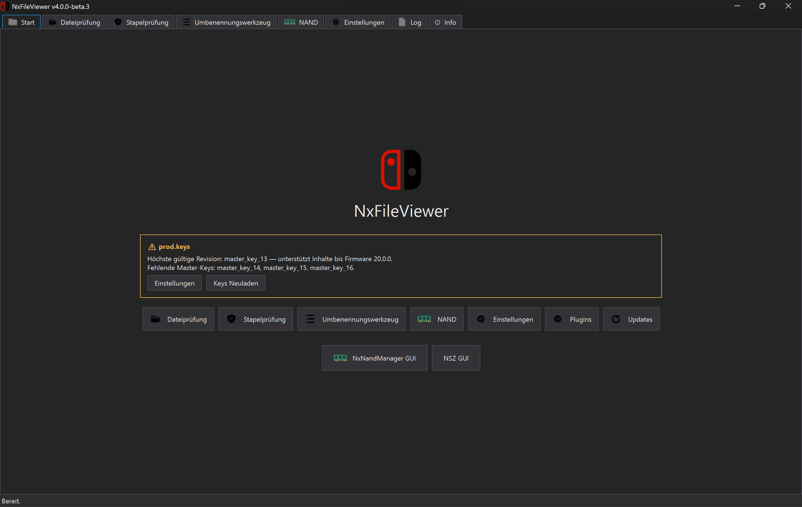
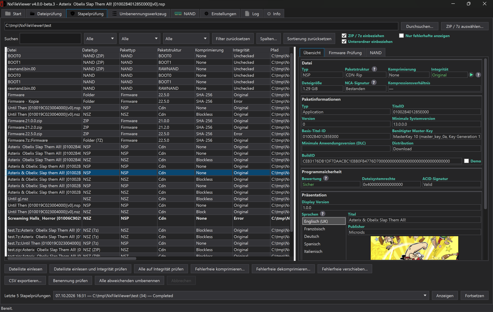

# NxFileViewer Fork v4

##

##

##

Browse, verify and manage Nintendo Switch packages in a Windows desktop application based on [LibHac](https://github.com/Thealexbarney/LibHac).

**[Download](https://github.com/sandmaennchen5/fork_NxFileViewer/releases)** · **[Documentation](docs/README.md)** · **[Screenshots](docs/Screenshots.md)** · **[Changelog](CHANGELOG.md)** · **[Discord](https://discord.gg/tjvhd3jw3d)**

## Get started

1. Download and extract the **x64**, **x86** or **Windows ARM64** WPF viewer ZIP matching your system.
2. Choose **self-contained** to include .NET, or install [.NET 10 Desktop Runtime](https://dotnet.microsoft.com/download/dotnet/10.0) for the standard ZIP.
3. Start `NxFileViewerFork.exe` from a writable folder and configure your keys under **Settings → Keys**.
4. Open a file, drop files/folders into Batch, or use the optional Explorer menu.

Firmware references and Explorer setup packages are separate downloads. The standalone LogViewer remains available through local builds and Build artifacts. See [installation and updates](docs/Application-updates.md).

The application version is **4.1.1**. See the [combined 4.1.1 release notes](CHANGELOG.md#411---2026-11-23).

Prereleases also include the **first converted Avalonia viewer application** for Windows, Linux and macOS. These are early beta versions: the conversion is in progress, and not all functions are implemented or tested. See [Avalonia beta builds](docs/Avalonia.md).

## LINUX and MacOS

For users who use or want to use Linux or MacOS, the first beta is available.

It would be great if anyone could test it and diligently report any bugs.
Since there might still be a few here.

Currently, I’m rebuilding everything in Avalonia and primarily testing it on Windows in order to then remove the WPF UI.

[BETA](https://github.com/sandmaennchen5/fork_NxFileViewer/releases#release-4.1.2-beta1)

## Features

| Feature | Capabilities |
| --- | --- |
| [File browser](docs/User-guide.md#file-check) | NSP, NSZ, XCI, XCZ, NCA and Super packages; content tree, metadata, images and exports |
| [Integrity checks](docs/User-guide.md#file-check) | NCA hashes and signatures, missing contents/keys, package structure and security information |
| [NUP (experimental)](docs/User-guide.md#nup-files) | Base game, update and DLC metadata, ExeFS/RomFS browsing and SHA-256 verification in File and Batch |
| [Batch processing](docs/User-guide.md#batch-check) | Multiple files/folders, selected-file actions, filtering, sorting, saved history and CSV/Excel export |
| [Renaming](docs/Renaming.md) | Independent game/update/DLC/Super/multi-package presets, custom variables, simulation and target folders |
| [Compression](docs/NSZ-plugin.md) | NSP ↔ NSZ and XCI ↔ XCZ using nicoboss/nsz or nscb_rust, with source/output verification |
| [Package tools](docs/PACKAGE_ENGINES.md) | Convert, merge and split NSP/XCI using nscb_rust or Kronos; merge order game → update → DLC |
| [Homebrew and SD](docs/SD-and-MTP.md) | NRO metadata, read-only NAX0, FAT32 split NCAs and emuMMC content discovery |
| [Sphaira MTP](docs/SD-and-MTP.md) | Import Switch files/folders into a local cache; experimental direct reading |
| [NAND](docs/NAND-plugin.md) | Read-only dump analysis and partition export through NxNandManager |
| [Archives](docs/User-guide.md#archives-and-firmware) | ZIP/7z, nested archives, game packages and firmware folders |
| [Firmware](docs/Firmware-verification.md) | Identify and verify firmware sets; online references and optional offline hashes |
| [Explorer integration](docs/Explorer-integration.md) | Classic/Windows 11 menus, file associations and multi-file open, verify and package actions |
| [Key management](docs/User-guide.md#keys-and-title-sources) | prod.keys/title.keys discovery, validation, custom paths and missing-key diagnostics |
| [Title sources](docs/Title-providers.md) | Configurable title-name providers and title websites |
| [Updates](docs/Application-updates.md) | Application/plugin update checks, architecture/runtime matching and verified downloads |
| [Diagnostics](docs/Logging.md) | Live logs, retained sessions and a separate [LogViewer](docs/LogViewer.md) |
| Interface | English, French, German and Spanish; light/dark/system themes; shared workspace with retained results |

Detailed workflows, configuration and limitations are in the **[documentation](docs/README.md)**.

## 🧭 Roadmap
### ✅ Done
- NAND File Explorer (like in Nx Game Info)
- Windows Explorer - Context Menu
- update .NET 10 (November 10, 2026 End of support .NET 8)
- Special sorting alphabetical by game (Base+Patch+DLC)
### ⏳ In Progress
- UI/UX Improvements
- Avalonia UI
- MTP (Sphaira) support
- compress tools NSZ + ncsb_rust
- SuperNSP / SuperXCI Split and Merge tools NSC_Builder + nscb_rust
- Automatic tool switching in case of failure
- NUP File Support
### 🔜 Planned
- Linux and MacOS
### 💭 Brainstorm / Ideas
- Plugin nxdumphost (Dump content from switch via pc host and directly into batch)

## Screenshots

[All screenshots](docs/Screenshots.md)

## Feedback and community

Report bugs or feature requests, find your Support ID and participate in polls under **Info**. See [feedback, polls and system reports](docs/Community.md) for public/private log choices, reminders, optional reporting and companion-service requirements.

## Development and credits

Build with the **.NET 10 SDK** on Windows; see [build, tests and publishing](docs/Development.md).
Default settings and naming presets are editable under [src/config](src/config/README.md).

Based on [Myster-Tee/NxFileViewer](https://github.com/Myster-Tee/NxFileViewer) and [LibHac](https://github.com/Thealexbarney/LibHac).
See [credits](CREDITS.txt), [license](LICENSE) and [third-party notices](docs/THIRD-PARTY-NOTICES.txt).
