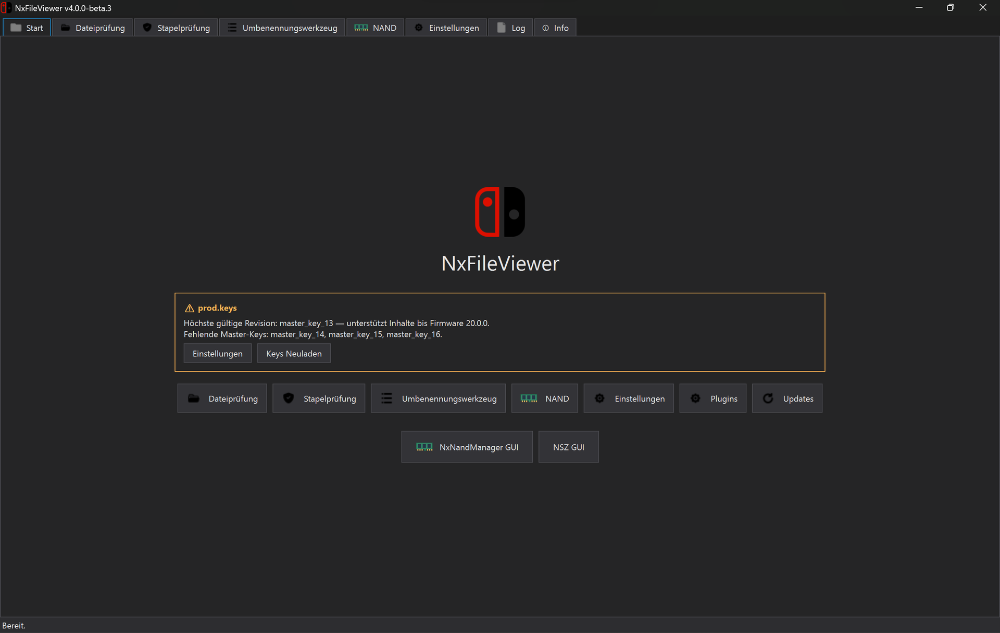
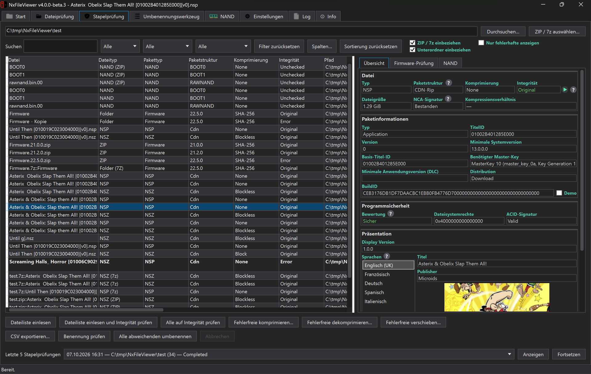

# NxFileViewer Fork v4

Browse, verify and manage Nintendo Switch packages in a Windows desktop application based on [LibHac](https://github.com/Thealexbarney/LibHac).

**[Download](https://github.com/sandmaennchen5/fork_NxFileViewer/releases)** · **[Documentation](docs/README.md)** · **[Screenshots](docs/Screenshots.md)** · **[Changelog](CHANGELOG.md)** · **[Discord](https://discord.gg/tjvhd3jw3d)**

## Get started

1. Download and extract the **x64** or **x86** viewer ZIP.
2. Choose **self-contained** to include .NET, or install [.NET 10 Desktop Runtime](https://dotnet.microsoft.com/download/dotnet/10.0) for the standard ZIP.
3. Start `NxFileViewerFork.exe` from a writable folder and configure your keys under **Settings → Keys**.
4. Open a file, drop files/folders into Batch, or use the optional Explorer menu.

Firmware references, the standalone LogViewer and Explorer setup packages are separate downloads. See [installation and updates](docs/Application-updates.md).

## Features

| Feature | Capabilities |
| --- | --- |
| [File browser](docs/User-guide.md#file-check) | NSP, NSZ, XCI, XCZ, NCA and Super packages; content tree, metadata, images and exports |
| [Integrity checks](docs/User-guide.md#file-check) | NCA hashes and signatures, missing contents/keys, package structure and security information |
| [Batch processing](docs/User-guide.md#batch-check) | Multiple files/folders, selected-file actions, filtering, sorting, saved history and CSV/Excel export |
| [Renaming](docs/Renaming.md) | Independent game/update/DLC/Super/multi-package presets, custom variables, simulation and target folders |
| [Compression](docs/NSZ-plugin.md) | NSP ↔ NSZ and XCI ↔ XCZ using nicoboss/nsz or nscb_rust, with source/output verification |
| [Package tools](docs/PACKAGE_ENGINES.md) | Convert, merge and split NSP/XCI using nscb_rust or Kronos; merge order game → update → DLC |
| [Homebrew and SD](docs/SD-and-MTP.md) | NRO metadata, read-only NAX0, FAT32 split NCAs and emuMMC content discovery |
| [Sphaira MTP](docs/SD-and-MTP.md) | Import Switch files/folders into a local cache; experimental direct reading |
| [NAND](docs/NAND-plugin.md) | Read-only dump analysis and partition export through NxNandManager |
| [Archives](docs/User-guide.md#archives-and-firmware) | ZIP/7z, nested archives, game packages and firmware folders |
| [Firmware](docs/Firmware-verification.md) | Identify and verify firmware sets; online references and optional offline hashes |
| [Explorer integration](docs/Explorer-integration.md) | Classic/Windows 11 menus, file associations and multi-file open, verify and package actions |
| [Key management](docs/User-guide.md#keys-and-title-sources) | prod.keys/title.keys discovery, validation, custom paths and missing-key diagnostics |
| [Title sources](docs/Title-providers.md) | Configurable title-name providers and title websites |
| [Updates](docs/Application-updates.md) | Application/plugin update checks, architecture/runtime matching and verified downloads |
| [Diagnostics](docs/Logging.md) | Live logs, retained sessions and a separate [LogViewer](docs/LogViewer.md) |
| Interface | English, French, German and Spanish; light/dark/system themes; shared workspace with retained results |

Detailed workflows, configuration and limitations are in the **[documentation](docs/README.md)**.

## Screenshots

[All screenshots](docs/Screenshots.md)

## Development and credits

Build with the **.NET 10 SDK** on Windows; see [build, tests and publishing](docs/Development.md).
Default settings and naming presets are editable under [src/config](src/config/README.md).

Based on [Myster-Tee/NxFileViewer](https://github.com/Myster-Tee/NxFileViewer) and [LibHac](https://github.com/Thealexbarney/LibHac).
See [credits](CREDITS.txt), [license](LICENSE) and [third-party notices](docs/THIRD-PARTY-NOTICES.txt).
